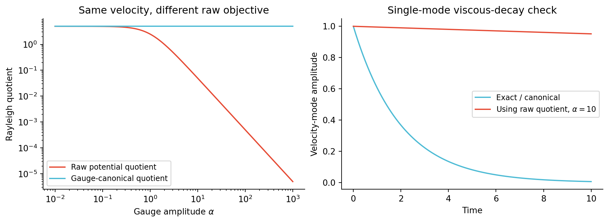
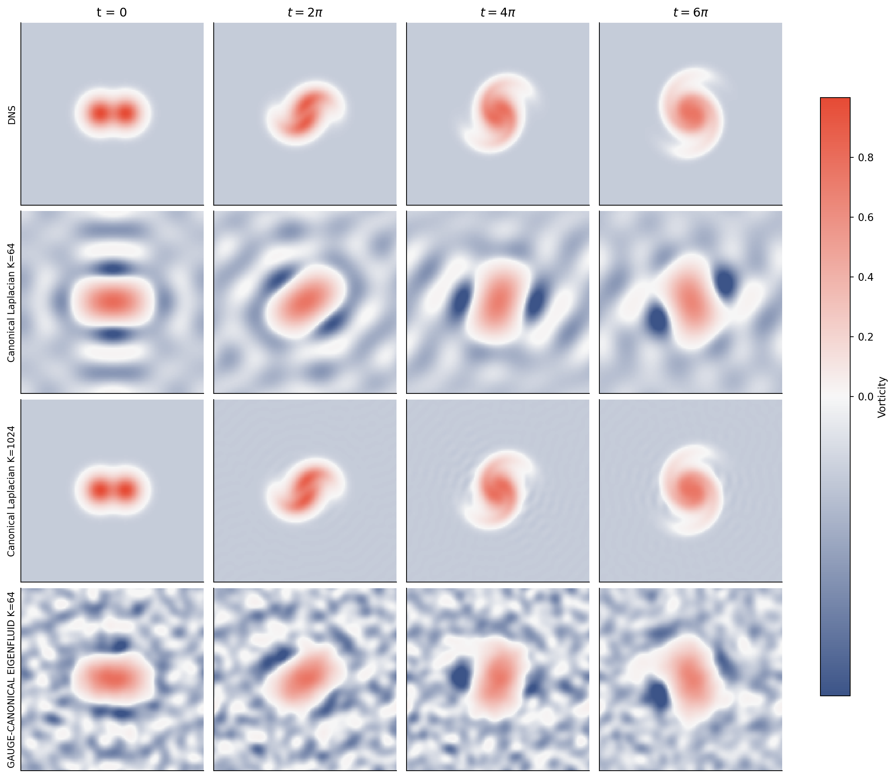

# GAUGE-CANONICAL EIGENFLUID：2D vortex merger 验证

## 结论

已从头完成 K=64、2000 epochs 的周期神经基训练，并用最新的 l=0.90 双涡合并 GT 做了 61 帧自主 Galerkin 演化。解析 Laplacian K=64/K=1024 已完整计算，可先用于检查理论。

数值实验支持**势函数 Rayleigh 商必须定义在固定 gauge 的代表元上**。对周期解析模态，固定 gauge 就是删除常数 Fourier 模态。标准的非零 Fourier 特征函数已经满足这个条件，因此再次 canonicalization 不改变速度，也不能由此声称流场精度有额外提升。

本实验是论文商空间思想的**周期边界特化**。论文正文中的 2D 零 Dirichlet 边界已经排除了常数；这时 projector 是恒等映射，不能再机械地减空间均值。本文档的三维 Poisson/Hodge 投影和跨几何泛化没有通过本次 2D 实验得到验证。

## 输入与协议

- 理论：[ICLR2027_Potential_Eigenfluids.tex](C:/Users/admin/Desktop/Eigenbasis/ICLR2027_Potential_Eigenfluids/ICLR2027_Potential_Eigenfluids.tex)；SHA256 `79e5098c2d0966c7fb9becea26476d00d94272944caf06d527d0664f545dd801`。
- GT：[vortex_merger_gt.h5](C:/Users/admin/Desktop/Eigenbasis/EigenFluid-SSS/2D_Vortex_Merger/outputs/gt_128_re350_l0p90_t6pi/vortex_merger_gt.h5)；SHA256 `3571fab887e0a0dc7c05d749e117811f368d7e7820087bf45898654743d15a1d`。
- `[0,2π)^2` 双周期，128×128，Re=350，间距 l=0.90，σ=0.1π，Γ=0.2π，ν=0.001074291366916876，终止时间 6π。
- GT 只用于初始速度投影和逐帧误差评估；后续帧没有重新拟合或注入 GT。
- 误差定义为两速度分量全部元素的普通 MSE，即 `mean((du²+dv²)/2)`；无归一化。
- 本地最新 K=64 raw-xy 旧版已去均值，但没有周期边界约束。本次使用 sin/cos 周期坐标输入，64 个独立 SIREN 输出网络，宽 64、五个仿射层、4096 个 IID 积分点、seed=20260907、2000 epochs。
- gauge 投影 → 初步排序 → 两遍 causal MGS → potential Rayleigh；使用原有显式 Jet1 和手写参数反传后端。并非通过改标签新增原本就存在的均值投影。
- 神经模型不使用解析特征函数监督。输入只有 x/y 的一阶周期坐标嵌入。
- 正谱和常速度 harmonic 扇区分开；本 GT 的平均速度数值为零，故 harmonic 系数为零。
- 有限精度神经模态使用完整速度质量矩阵与 curl 刚度矩阵构造 ROM；不直接拿势函数 Rayleigh 值代替尚未收敛模态的粘性算子。

## 最快的解析反例

取 `φ=√2/(2π) cos(x+2y)`，其 L² 范数为 1，特征值为 5。令 `ψα=φ+α/(2π)`，它们表示完全相同的速度，但：

`Rraw(ψα)=5/(1+α²)`，而 `Pgf ψα=ψα−mean(ψα)=φ`，所以 `Rgf=5`。

α=1000 时，原始商为 4.999995e-06，canonical 商为 5；投影后势函数最大差 1.421e-14。注意 `φ+常数` 是同一个速度的另一势代表，**不是**同一正特征值的 Laplacian 特征函数。这恰好说明为什么不能直接把任意势代表的商当作物理特征值。

64 个解析模态的 potential Gram 缺陷 3.438e-15，velocity Gram 缺陷 1.114e-14，独立 FFT 特征残差最大 1.804e-12；gauge 扰动前后速度差最大 1.679e-14。

Dirichlet 反控：在 `[0,π]^2`，`sin(x)sin(y)` 已满足零边界。若减去它的均值 `4/π²`，反而将边界改成 `−4/π²`，不再属于原本的算子定义域。

谱矩层级混合模态验证给出 `Rpot=1.8 < Rvel=3.222222 < Rvort=4.448276`，与文档中的不等式一致。



## 双涡合并结果

| 方法 | t=0 速度 MSE | t=6π 速度 MSE | 61 帧平均速度 MSE |
|---|---:|---:|---:|
| 解析 Laplacian K=64 | 2.54142016e-05 | 8.30475773e-05 | 4.97865781e-05 |
| 解析 Laplacian K=1024 | 1.38456772e-19 | 2.34185927e-09 | 1.31156547e-09 |
| GAUGE-CANONICAL EIGENFLUID K=64 / 2000 epochs | 2.80435618e-05 | 7.27837624e-05 | 4.99070297e-05 |

解析 K=1024 能解析细尺度合并过程；K=64 的初始双涡已明显受低维截断平滑。两者比较含有模态数差异，不能用作 gauge 消融。

神经 K=64 的平均特征值相对误差为 0.510%，最大为 7.041%。速度特征残差均值 0.3023、最大 1.7816，因此还不能把所有训练模态称为精确特征模态。周期 seam 的速度误差和 gauge 测试值见完整 JSON。这里不将神经版与解析版的差异归因于 gauge。

重特征值按整簇 projector 距离评估；K=64 的截断落在 λ=20 的重根内部，因此不对最后一个不完整簇作唯一子空间的准确性判断。解析基在该簇中采用固定整数波向量排序；神经基可以选择不同的同特征值子空间。



## 验证与边界

- 3 项自动测试通过：真实神经后端常数 gauge 不变性；Jet2 周期 seam；解析投影/Dirichlet 反控。
- K=64 的独立 Fourier 和速度张量 Galerkin 实现对照，完整轨迹最大速度差 1.055e-15。
- K=1024 将积分网格从 64² 提升至 128²、最大步长从 .01 减半至 .005 后，最大速度变化 4.454e-12，最大涡量变化 6.251e-11。
- 解析快速验证及两条主轨迹总耗时 20.84 秒；独立实现和加密检查另计。
- 本次训练短于两小时，不需要触发工作区的每半小时长训练监视规则。
- 正文 convention 为 `u=(ψ_y,−ψ_x)`。附录 annulus 示例若目标为 `+eθ/(2πr)`，对应流函数应为 `−log(r)/(2π)`；当前写为正号，方向相反。这是一个符号一致性问题，不改变 gauge 论证。理论源文件未修改。

## 文件

- [解析 gauge 图 PDF](outputs/analytic/gauge_necessity.pdf)
- [解析流场 PDF](outputs/analytic/vortex_merger_analytic_comparison.pdf)
- [全部对照 PDF](outputs/final_comparison.pdf)
- [解析 K=64 基与特征值](outputs/analytic/analytic_k64_basis.npz)
- [解析 K=1024 全部时序](outputs/analytic/rollout_k1024/fields.npz)
- [神经训练配置](configs/k64_periodic_gauge_canonical_e2000.json)
- [神经权重](outputs/neural_k64_e2000/run_001/checkpoints/hardcoded_sss_frozen.npz)
- [神经最终指标](outputs/neural_epoch2000_evaluation/summary.json)
- [解析完整指标](outputs/analytic/summary.json)

## 复现

从本目录运行：

```powershell
python scripts/verify_analytic.py
python scripts/prepare_gauge_canonical.py --config configs/k64_periodic_gauge_canonical_e2000.json --output-dir outputs/new_run/inputs
python scripts/train_gauge_canonical.py --resume outputs/new_run/inputs/initial_epoch0000.npz --run-dir outputs/new_run/run_001 --validation-pack outputs/new_run/inputs/fixed_validation_iid_uniform_v1.npz
python scripts/evaluate_neural.py --checkpoint outputs/new_run/run_001/checkpoints/hardcoded_sss_frozen.npz --output outputs/new_run/evaluation
python -m pytest scripts/test_periodic_gauge.py -q
```
