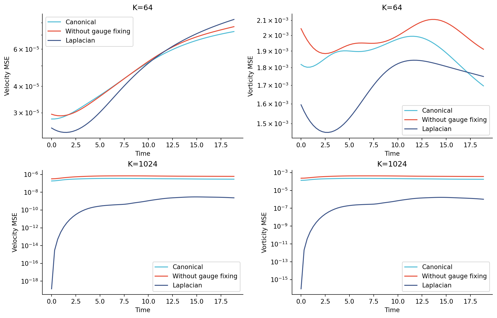
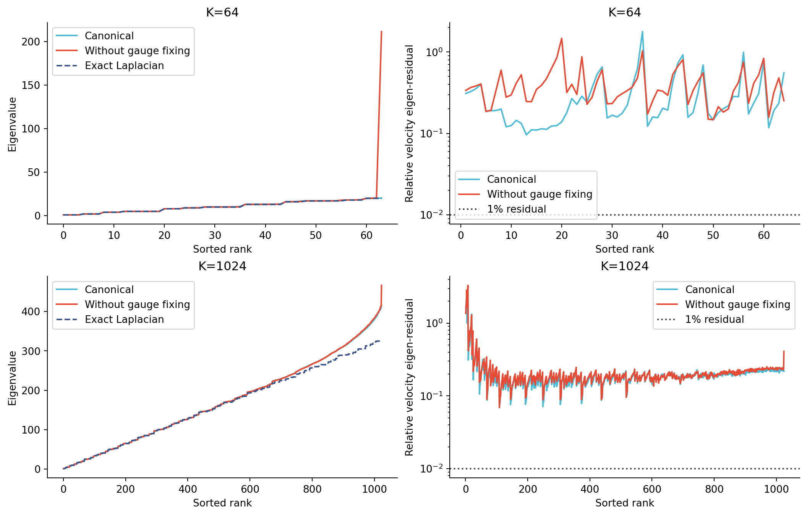

# Vortex merger：64 / 1024 模态完整对比

视频为两行四列：上行64模态，下行1024模态；每行依次为GT、canonical Eigenfluid、无规范Eigenfluid、解析Laplacian。各方法仅在第一帧投影GT，随后自主演化到 t=6π。

- [速度与流线视频](video/vortex_merger_velocity_64_1024.mp4)
- [涡量视频](video/vortex_merger_vorticity_64_1024.mp4)
- [最终速度图 PDF](video/velocity_final.pdf)
- [最终涡量图 PDF](video/vorticity_final.pdf)
- [全部数值 CSV](final_metrics.csv)

## MSE：第一帧、最后一帧与全时段

速度 MSE 为全部网格与两个分量的普通均方误差；涡量 MSE 为全部网格的标量均方误差。无归一化。61帧平均值包含首尾帧。

| 模态数 | 方法 | 初始速度 MSE | 最后速度 MSE | 平均速度 MSE | 最后涡量 MSE | 平均涡量 MSE |
|---|---|---:|---:|---:|---:|---:|
| 64 | Gauge-canonical Eigenfluid | 2.804356e-05 | 7.278376e-05 | 4.990703e-05 | 1.696647e-03 | 1.886724e-03 |
| 64 | Eigenfluid without gauge fixing | 2.953892e-05 | 7.676645e-05 | 5.101834e-05 | 1.911946e-03 | 1.987358e-03 |
| 64 | Analytic Laplacian | 2.541420e-05 | 8.304758e-05 | 4.978658e-05 | 1.749321e-03 | 1.693454e-03 |
| 1024 | Gauge-canonical Eigenfluid | 1.846379e-07 | 2.923956e-07 | 3.151363e-07 | 1.769435e-04 | 1.969736e-04 |
| 1024 | Eigenfluid without gauge fixing | 3.198576e-07 | 6.076272e-07 | 6.135548e-07 | 3.612877e-04 | 3.810644e-04 |
| 1024 | Analytic Laplacian | 1.384568e-19 | 2.341859e-09 | 1.311565e-09 | 1.027550e-06 | 7.358928e-07 |

- 64 模态：canonical 相对无规范，末帧速度 MSE 变化 -5.19%，末帧涡量 MSE 变化 -11.26%；全时段平均速度 MSE 变化 -2.18%。负号表示误差降低。
- 1024 模态：canonical 相对无规范，末帧速度 MSE 变化 -51.88%，末帧涡量 MSE 变化 -51.02%；全时段平均速度 MSE 变化 -48.64%。负号表示误差降低。

## 是否满足 Laplacian relation

同时检查 `−Δψ=λψ` 和 `−Δu=λu`。定义

`rψ = ||−Δψ−λψ|| / (|λ| ||ψ||)`，`ru = ||−Δu−λu|| / (|λ| ||u||)`。

神经基用解析 Jet2/Jet3 导数求残差；解析 Fourier 基用独立 FFT 微分交叉验证。残差越接近0，越满足特征方程。仅比较特征值大小不足以证明特征函数正确。

另外对全部原始网络模态做了 FFT 与 Jet 导数交叉验证（`derivative_crosscheck.json`）。若近常数势导致单精度采样值的 FFT 微分放大舍入误差，则用相同训练权重重新进行双精度推理复查；该检查不改变训练模型或视频中的轨迹。

“正谱”列是两组去掉势常数后，在各自学到的子空间内做的统一离线 Ritz 诊断；“原生”列使用各自训练时的 gauge 处理。无规范组的近常数模态可使原生 λ 接近0，进而产生很大的相对特征残差。该离线诊断不改变视频中的动力学。

| 模态数 | 方法 | 正特征值平均相对误差 | 正谱 rψ 均值 | 正谱 ru 均值 | 原生 rψ 均值 | 原生 ru 均值 |
|---|---|---:|---:|---:|---:|---:|
| 64 | Gauge-canonical Eigenfluid | 0.510% | 1.0509e-01 | 3.0233e-01 | 1.0509e-01 | 3.0233e-01 |
| 64 | Eigenfluid without gauge fixing | 15.501% | 1.3646e-01 | 4.0981e-01 | 4.5782e+02 | 1.3770e+07 |
| 64 | Analytic Laplacian | 0.000% | 2.5126e-13 | 2.5329e-13 | 2.5126e-13 | 2.5329e-13 |
| 1024 | Gauge-canonical Eigenfluid | 3.133% | 1.0821e-01 | 1.9952e-01 | 1.0821e-01 | 1.9952e-01 |
| 1024 | Eigenfluid without gauge fixing | 3.217% | 1.1289e-01 | 2.1712e-01 | 5.9713e+01 | 3.9226e+06 |
| 1024 | Analytic Laplacian | 0.000% | 7.0315e-14 | 7.0475e-14 | 7.0315e-14 | 7.0475e-14 |

**解析 Laplacian 满足特征方程至浮点误差。神经基仍有非零特征残差，不能把全部模态视为已经收敛的精确 Laplacian 特征函数。** 每个模态的 λ、残差和 gauge 比例见各 evaluation 目录下的 `eigenrelation_all_modes.csv`。

## 匹配条件与求解方法

- GT：周期 `[0,2π)^2`，128²，Re350，双涡间距0.90，61帧从0到6π。
- 同一行的有/无规范训练使用相同初值、网络结构、积分点生成规则、优化器和2000轮预算；只切换势均值投影及其伴随。
- 64模态使用宽64、1组周期频率、seed20260907；1024模态复用已有宽32、6组周期频率、seed20260904的 canonical 训练，并从相同初始权重补训无规范组。跨行不仅模态数不同，网络设置也不同；不能将跨行变化纯粹归因于 K。
- 每个正谱神经空间均使用完整速度质量矩阵、curl 刚度矩阵和旋转形式 Galerkin 非线性项。速度 Ritz 变换只改变坐标；没有把尚未收敛的势 λ 直接作为粘性系数。
- 统一使用 float64 ETDRK4，最大时间步0.01；只投影第一帧。解析Laplacian使用独立、去混叠的 Fourier-Galerkin 实现。64模态矩阵自由实现与先前张量实现已核对到约1e-15。
- 视频包含全部61个真实输出时刻，每秒显示5个样本帧，编码为30fps；首尾各停留1秒，未用图像插值虚构流场。
- 色标在所有面板与时间上固定；速度视频的红线是各自速度场的流线。
- 原始输入、GT路径与模型哈希见 [protocol.json](protocol.json)；本次单种子结果不代表跨种子统计显著性。
