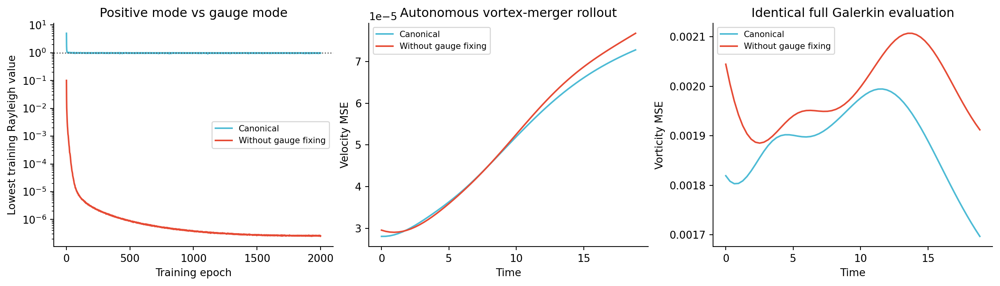
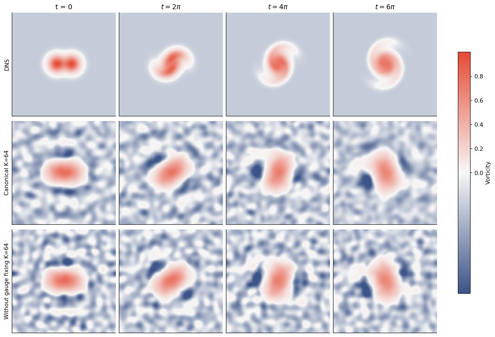

# Eigenfluid：canonical 与无规范的配对训练

## 结论

**在本次固定初始化的配对实验中，canonical 对预先指定的“61帧平均速度 MSE”有改善，相对下降 +2.18%。**

两组均为 K=64、2000 epochs。下表的改善百分比定义为 `(无规范误差−canonical误差)/无规范误差`；正数表示 canonical 更好，负数表示更差。不能把这一次初始化的结果直接推广为所有随机种子或其他几何的保证。

| 指标 | 无规范 | Canonical | Canonical 改善 |
|---|---:|---:|---:|
| 初始速度 MSE | 2.95389168e-05 | 2.80435618e-05 | +5.06% |
| 61帧平均速度 MSE（主指标） | 5.10183378e-05 | 4.99070297e-05 | +2.18% |
| 末帧速度 MSE | 7.67664478e-05 | 7.27837624e-05 | +5.19% |
| 61帧平均涡量 MSE | 1.98735836e-03 | 1.88672418e-03 | +5.06% |
| 末帧涡量 MSE | 1.91194607e-03 | 1.69664704e-03 | +11.26% |
| 逐帧最优投影速度 MSE（仅诊断） | 1.55442985e-05 | 1.42461632e-05 | +8.35% |

同预算的中间检查如下。结果随训练轮次波动；终点比较固定使用2000轮，没有按 GT 指标挑选 checkpoint。

| 训练轮数 | 无规范平均速度 MSE | Canonical 平均速度 MSE | Canonical 改善 |
|---|---:|---:|---:|
| 400 | 7.3317772e-05 | 7.0166436e-05 | +4.30% |
| 800 | 6.3516092e-05 | 6.1566098e-05 | +3.07% |
| 1200 | 6.1575259e-05 | 6.7668530e-05 | -9.90% |
| 1600 | 6.2398732e-05 | 6.6554651e-05 | -6.66% |
| 2000 | 5.1018338e-05 | 4.9907030e-05 | +2.18% |

## 严格匹配了什么

- 双周期 `[0,2π)^2`；GT 为 128²、Re=350、l=0.90，时段 0 到 6π，共61帧。
- 两组均为64个网络输出、宽64、五层仿射 SIREN、相同周期 sin/cos 输入。`canonical_siren=true` 仅是两组共同的 SIREN 初始化选项，**不是 gauge 开关**。
- 完全相同的初始权重文件，SHA256 `c8f6f672c93476995ce424c0cd5f8828d222ee6ffa8e2afaacffc69385434b29`。
- 完全相同的4096点验证包，SHA256 `7640f4320d353d8e3cacb4a33439ef6ff329fd349a156a8689c3848370921c87`。
- 每轮训练使用相同 PCG64 IID 点，种子 `20260907 + epoch×1009`，每轮4096点；相同 Adam、学习率计划、两遍 causal MGS、精度与停止轮数。
- 唯一数学差别：canonical 在排序、势质量矩阵和正交化前执行 `ψ−mean(ψ)`，并在反传执行其伴随；无规范组关闭这两处操作。详见 [实际函数差异](backend_function.diff)。
- canonical 组复用刚完成的同条件训练；无规范组从同一 epoch-0 权重重新训练，并非从 canonical 的训练后权重继续。
- 开关开启时，forward loss 和一次训练更新与原后端逐元素完全相同；3项消融测试通过。原始后端文件在实验期间未改变。

## 为什么原始 loss 较低不代表更好

无规范训练后的最低势 Ritz 值为 **2.59677448e-07**，canonical 为 **1.00002816**；这个周期正谱的正确下界是1。

无规范组的一个势 Ritz 模态有 **99.99999988%** 的 L² 能量来自常数 gauge。常数本来是零速度方向，却被无规范的势优化纳入模态空间。canonical 组训练后势 Ritz 模态的最大常数能量比例只有 **5.921e-30**。

这说明 canonical 在优化目标中排除了非物理常数方向。不过，本次无规范神经模态并非数学上严格常数，速度质量矩阵仍数值解析出 **64** 维；不能简单宣称其物理速度基已经降成63维。

两组训练后张成空间的正谱误差也作了独立诊断：先去掉常数再评估同一物理空间的势特征值，canonical 平均相对误差 **0.510%**，无规范 **15.501%**。这只是离线谱诊断，不向 rollout 注入修正。

## 流体评估没有替无规范组补 gauge

两组都直接从网络输出的速度 `u=(ψ_y,−ψ_x)` 和涡量组装完整速度质量矩阵、curl 刚度矩阵与旋转形式 Galerkin 非线性张量。此路径不使用势函数去均值、势 Ritz 旋转或训练 Rayleigh 值作为粘性系数。之后的速度正交坐标变换对两组完全一致，并保留全部数值可解析的64维。

只在 t=0 投影 GT 初值，然后用相同 ETDRK4 步长 ≤0.01 自主演化；之后没有重新拟合 GT。逐帧最优投影单独列为表达能力诊断，不用于更新轨迹。

canonical 的这套直接速度评估与上一轮先作势 Ritz 坐标变换的评估，整条轨迹最大速度差为 **1.735e-15**，验证了坐标变换没有改变结论。

两组都将最大时间步从0.01减半至0.005重新评估，平均/末帧速度及平均涡量 MSE 的最大相对变化为 **3.774e-13**，远小于观察到的组间差异；详见 [时间加密检查](time_refinement.json)。





## 数据和复现

- [匹配协议和输入哈希](protocol.json)
- [汇总 JSON](comparison.json)
- [Canonical 全部指标](canonical/evaluation/summary.json)
- [无规范全部指标](raw/evaluation/summary.json)
- [无规范模型权重](raw/run_001/checkpoints/hardcoded_sss_frozen.npz)
- [指标图 PDF](canonical_vs_raw_metrics.pdf)
- [流场对照 PDF](canonical_vs_raw_vortex_merger.pdf)
- [无规范全部时序](raw/evaluation/fields.npz)

从 GAUGE_CANONICAL_EIGENFLUID 目录运行：

```powershell
python scripts/train_gauge_ablation.py --resume outputs/gauge_ablation/raw/inputs/initial_epoch0000.npz --run-dir outputs/gauge_ablation/raw_rerun --validation-pack outputs/gauge_ablation/raw/inputs/fixed_validation_iid_uniform_v1.npz
python scripts/evaluate_ablation.py --checkpoint outputs/gauge_ablation/raw_rerun/checkpoints/hardcoded_sss_frozen.npz --output outputs/gauge_ablation/raw_rerun/evaluation
python -m pytest scripts/test_gauge_ablation.py -q
```
