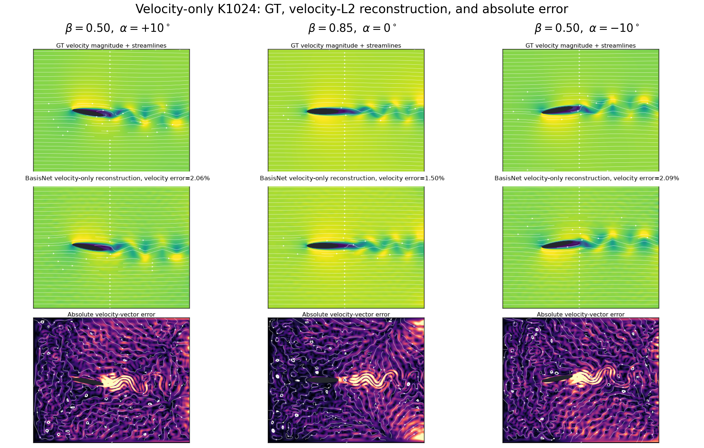
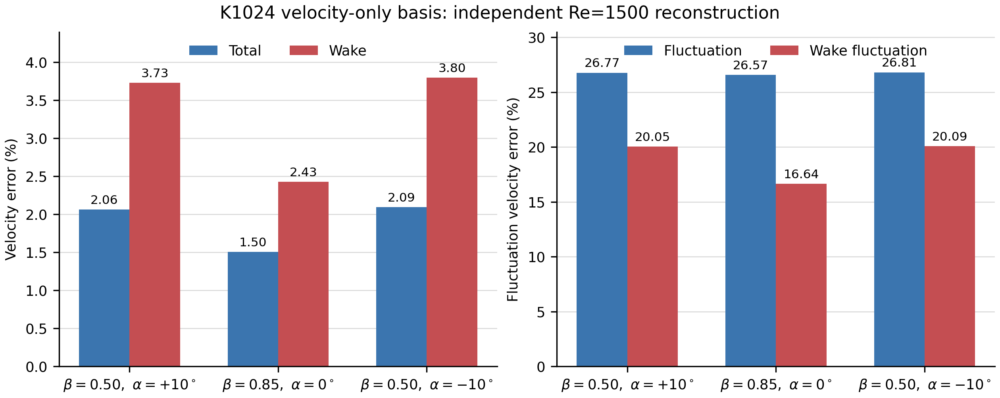

# BasisNet case: 2D airfoil

This case learns a continuous, parameter-dependent spatial basis for
left-to-right flow past a two-dimensional analytic airfoil. The published
airfoil training protocol is velocity-only: its objective is the velocity
Rayleigh quotient, and no vorticity term contributes to optimization.

The basis is conditioned on:

- `beta in [0, 1]`, which controls the thickness ratio
  `t/c = 0.08 + 0.10 beta`;
- `alpha in [-12, 12] degrees`, the angle of attack about the fixed
  quarter-chord point.

Basis training is unsupervised. It does not read Navier--Stokes snapshots,
numerical eigenfunctions, or labeled flow fields. Independent D2Q9-TRT
Navier--Stokes data are used only after checkpoint selection for linear
projection, error evaluation, and rendering.

## Published K1024 protocol

- Domain: `[0, 10] x [-4, 4]`
- Analytic `C-infinity` elliptical airfoil, chord `c=2`, quarter chord at
  `(3, 0)`
- Thickness ratio `0.08..0.18`; angle of attack `-12..12 degrees`
- `K=1024` shared, fixed-identity modes
- Four hidden sine layers of width 64 and six Fourier frequencies
- 4096 fresh mixed Sobol points per epoch: 50% global, 25% airfoil
  neighborhood, 25% wake
- 4096 immutable validation points for each of nine joint parameter cases
- FP16 hidden-layer shadow weights; FP32 boundary layers, reductions, master
  weights, Adam state, peeling, and Ritz algebra
- One FP64 modified Gram--Schmidt reorthogonalization pass
- Divergence-free velocity obtained analytically from a streamfunction
- Base learning rate `8e-4`; validation every 50 epochs; checkpoint every 100
  epochs; early-stopping patience 1000 epochs
- Objective: velocity Rayleigh `R_u / 80`

The versioned configuration is
[`k1024_c2_sobol_1000_fp16_velocity_only.json`](configs/k1024_c2_sobol_1000_fp16_velocity_only.json).
Generated checkpoints, logs, and raw evaluation outputs remain excluded from
Git. The compact result record and curated figures are versioned below.

The earlier K256 setup remains available through `k256_final.json` as a legacy
velocity-only baseline.

## Validated velocity-only result

The 1000-epoch run selected epoch 1000 with fixed-validation objective
`1.3789594584`, validation velocity Rayleigh `110.31675668`, rank `1024/1024`,
and orthogonality error `1.03e-14`. Accumulated active training time was
`33,954.25 s` (`9:25:54`). The training objective and all coefficient fits used
velocity only.

The frozen checkpoint was evaluated on the middle snapshot (`20/41`) of three
independent Re=1500, `1001 x 801` D2Q9-TRT trajectories:

| `beta`, `alpha` | Total velocity | Wake velocity | Fluctuation velocity | Wake fluctuation velocity |
| --- | ---: | ---: | ---: | ---: |
| `0.50`, `+10 deg` | 2.0624% | 3.7287% | 26.7743% | 20.0520% |
| `0.85`, `0 deg` | 1.5049% | 2.4286% | 26.5748% | 16.6408% |
| `0.50`, `-10 deg` | 2.0939% | 3.7968% | 26.8117% | 20.0897% |
| **Mean** | **1.8871%** | **3.3180%** | **26.7202%** | **18.9275%** |

The machine-readable record is
[`reports/k1024_velocity_only_results.json`](reports/k1024_velocity_only_results.json).





[Vector PDF of the error summary](assets/k1024_velocity_only/velocity_error_summary.pdf)

## Reproduce the velocity-only run

Run all commands from the repository root. Recommended environment: Python
3.11--3.13, a CUDA GPU with at least 16 GB, CuPy matching CUDA, PyTorch 2.5 or
newer for the independent LBM path, and `ffmpeg` for videos.

```powershell
python -m pip install -e ".[dev]"
python -m pytest -q BasisNet/cases/2D_airfoil/tests
python -m ruff check BasisNet/cases/2D_airfoil
```

Train from deterministic epoch-0 weights and an immutable validation pack:

```powershell
$case = "BasisNet\cases\2D_airfoil"
$config = "$case\configs\k1024_c2_sobol_1000_fp16_velocity_only.json"
$run = "$case\results\k1024_c2_sobol_1000_fp16_velocity_only\run_001"

python -u "$case\scripts\train.py" `
  --config $config `
  --run-dir $run
```

Resume only from a complete checkpoint:

```powershell
python -u "$case\scripts\train.py" `
  --config $config `
  --run-dir $run `
  --resume "$run\checkpoints\hardcoded_epoch_0600.npz"
```

## Independent GT and evaluation

Generate formal Re=1500 D2Q9-TRT reference data after training:

```powershell
python "$case\scripts\solve_ns.py" `
  --config $config `
  --solver-config "$case\configs\gt_re1500_separated.json" `
  --beta 0.5 `
  --alpha-deg 10 `
  --output "$run\gt_beta050_alpha_p10.npz"
```

The formal solver uses a `1001 x 801` isotropic lattice, TRT-D2Q9 collision,
`Re_c=1500`, 60,000 steps, a 40,000-step warm-up, and 41 post-warm-up
snapshots. High-angle GT must pass the separated-wake quality gate.

Evaluate three typical cases with an existing velocity-only checkpoint:

```powershell
$eval = "$case\results\k1024_velocity_only_three_cases"

python -u "$case\scripts\evaluate_three_typical_cases.py" `
  --checkpoint "$run\checkpoints\hardcoded_best_model.npz" `
  --output-root $eval `
  --top-gt "PATH_TO_BETA050_ALPHA_P10_GT.npz" `
  --middle-gt "PATH_TO_BETA085_ALPHA_0_GT.npz" `
  --phase 0.5 `
  --ritz-quadrature 4096 `
  --field-batch 32768
```

Compare the frozen learned basis with a rectangular Laplacian K1024 basis:

```powershell
python -u "$case\scripts\evaluate_three_typical_laplacian1024.py" `
  --pinn-root $eval `
  --output-root "$eval\laplacian1024_vs_pinn" `
  --airfoil-config $config `
  --modes 1024 `
  --projection-points 32768 `
  --field-batch 32768
```

Coefficient fitting in these evaluation scripts is velocity L2 only.

## Implementation layout

```text
2D_airfoil/
|-- assets/k1024_velocity_only/
|-- configs/
|   |-- k1024_c2_sobol_1000_fp16_velocity_only.json
|   |-- gt_re1500_separated.json
|   `-- k256_final.json
|-- reports/k1024_velocity_only_results.json
|-- scripts/
|   |-- train.py
|   |-- prepare_hardcoded_run.py
|   |-- train_hardcoded.py
|   |-- solve_ns.py
|   |-- evaluate_single_gt.py
|   |-- evaluate_three_typical_cases.py
|   |-- evaluate_three_typical_laplacian1024.py
|   `-- plot_published_velocity_only_result.py
|-- src/eigenfluid_sss/basisnet/airfoil2d/
|   |-- hardcoded_backend.py
|   |-- hardcoded_postprocess.py
|   `-- ns_reference.py
`-- tests/test_smoke.py
```

## Reproducibility and artifact policy

- Training seed: `20260801`.
- Parameter and spatial samples use deterministic scrambled Sobol sequences.
- Peeling order is fixed; modes are never sorted or swapped.
- Initialization and validation packs are generated independently of CuPy.
- Results can vary slightly with CUDA, CuPy, and BLAS versions.
- Raw `results/` trees, checkpoints, GT NPZ caches, logs, frames, and videos
  are ignored. Source, velocity-only configurations, tests, compact validated
  reports, and curated figures are versioned.
