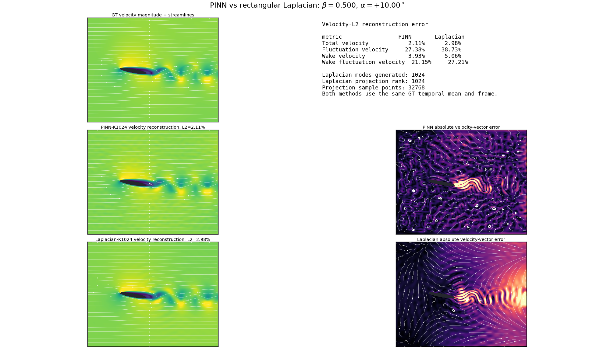
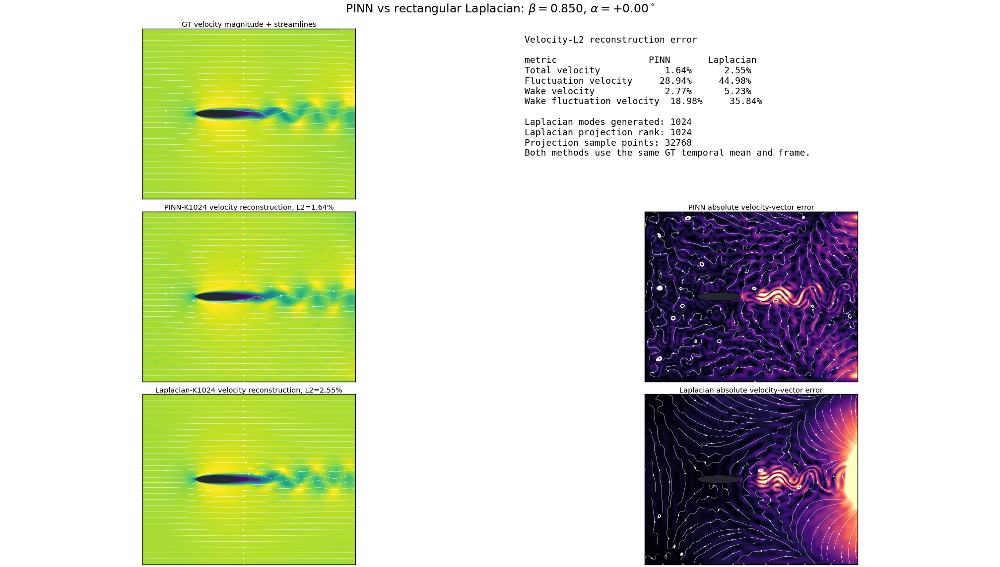
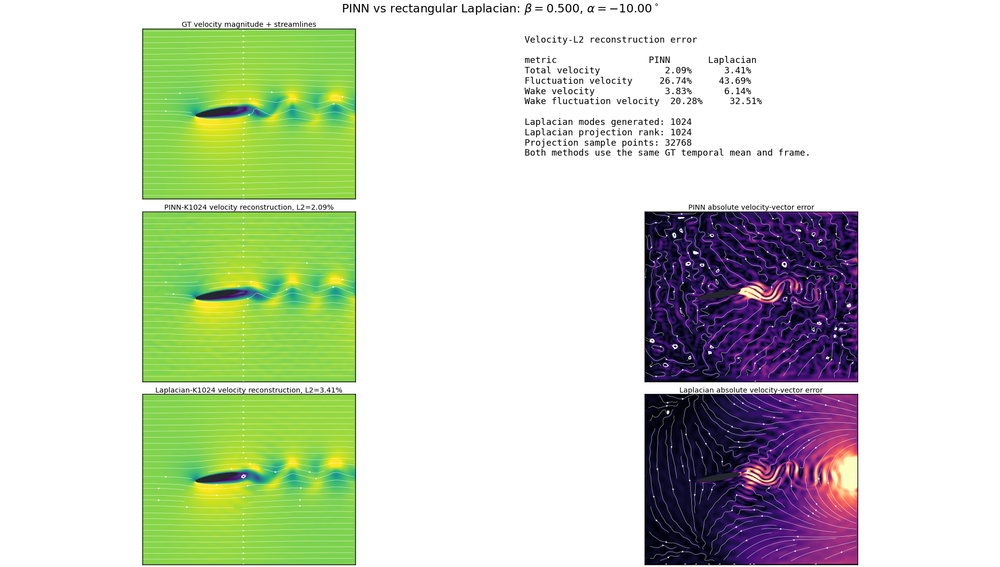

# BasisNet case: 2D airfoil

This case learns a continuous, parameter-dependent spatial basis for
left-to-right flow past a two-dimensional analytic airfoil. The current
experiment uses `K=1024` shared modes and conditions every mode on:

- `beta in [0, 1]`, which controls the thickness ratio
  `t/c = 0.08 + 0.10 beta`;
- `alpha in [-12, 12] degrees`, the angle of attack about the fixed
  quarter-chord point.

Basis training is unsupervised: it never reads Navier--Stokes snapshots,
numerical eigenfunctions, or labeled flow fields. Independent D2Q9-TRT
Navier--Stokes data are used only after checkpoint selection for linear
projection, error evaluation, and rendering.

> The K1024 numbers below are preliminary experimental results recorded on
> 2026-08-02. Raw checkpoints and GT archives remain excluded from Git. The
> compact machine-readable record is
> [`reports/k1024_preliminary_results.json`](reports/k1024_preliminary_results.json).

## Current K1024 protocol

- Domain: `[0, 10] x [-4, 4]`
- Analytic `C-infinity` elliptical airfoil, chord `c=2`, quarter chord at
  `(3, 0)`
- Thickness ratio `0.08..0.18`; angle of attack `-12..12 degrees`
- `K=1024` shared, fixed-identity modes
- Four hidden sine layers of width 64 and six Fourier frequencies
- 4096 fresh mixed Sobol points per epoch: 50% global, 25% airfoil
  neighborhood, 25% wake
- 4096 immutable validation points for each of nine joint parameter cases
- FP16 hidden-layer shadow weights; FP32 boundary layers, reductions, master
  weights, Adam state, peeling, and Ritz algebra
- Raw-mode forward batch size 32
- One FP64 modified Gram--Schmidt reorthogonalization pass
- Divergence-free velocity obtained analytically from a streamfunction
- Double-zero perturbation envelope at inlet, airfoil, top, and bottom
- Base learning rate `8e-4`; validation every 50 epochs; checkpoint every 100
  epochs; early-stopping patience 1000 epochs

Two matched configurations are included:

| Experiment | Objective | Epoch budget | Configuration |
| --- | --- | ---: | --- |
| Hybrid | `0.5 (R_u / 80) + 0.5 (R_omega / 232)` | 10,000 | [`k1024_c2_sobol_10000_fp16_hybrid50.json`](configs/k1024_c2_sobol_10000_fp16_hybrid50.json) |
| Velocity-only ablation | `R_u / 80` | 1,000 | [`k1024_c2_sobol_1000_fp16_velocity_only.json`](configs/k1024_c2_sobol_1000_fp16_velocity_only.json) |

The vorticity term uses 512 full-domain four-neighborhood finite-difference
anchors per epoch. It changes the training objective but does not introduce
NS supervision.

## Preliminary training results

The hybrid run reached epoch 4300 before it was stopped for evaluation. Its
selected checkpoint is epoch 650, where the fixed-validation joint objective
was lowest. Continuing the run did not improve that selection metric and the
raw effective rank later fell to 1002, so epoch 650 is the evaluation model.

| Quantity | Hybrid K1024 selected checkpoint |
| --- | ---: |
| Checkpoint epoch | 650 |
| Joint validation objective | 0.5280304703 |
| Validation velocity Rayleigh `R_u` | 36.27116149 |
| Validation vorticity Rayleigh `R_omega` | 139.81976992 |
| Validation P95 / maximum | 0.54670135 / 0.54834647 |
| Raw rank | 1024 / 1024 |
| Orthogonality error | `2.61e-12` |
| Accumulated active time through epoch 650 | 14,031.13 s (3:53:51) |

The velocity-only ablation starts from the exact same epoch-0 weights and
uses the exact same immutable validation pack. The published in-progress
snapshot at epoch 200 had validation `R_u / 80 = 1.6993393228`,
`R_u = 135.94714582`, rank `1024/1024`, and orthogonality error `9.77e-15`.
Its final three-case comparison should be made only after the 1000-epoch run
finishes; the epoch-200 value is not presented as a final result.

The earlier K256 experiment remains reproducible with `k256_final.json`, but
it is now a legacy baseline rather than the primary result. Its best recorded
validation value was `0.337540` at epoch 5800 under the velocity-only K256
objective, which is not numerically comparable to the normalized hybrid K1024
objective.

## Three-case velocity reconstruction

The epoch-650 hybrid checkpoint was evaluated on the middle snapshot
(`20/41`) of three independent Re=1500, `1001 x 801` D2Q9-TRT trajectories.
Coefficients were fit by velocity L2 only. All three neural Ritz bases and all
three rectangular Laplacian projections had rank `1024`.

The figures use the historical `PINN` label for the learned neural basis. The
model is physics-informed through the Rayleigh objective and analytic
constraints, but it is not trained against the NS residual or GT snapshots.

| `beta`, `alpha` | Learned K1024 total | Laplacian K1024 total | Learned wake | Laplacian wake | Learned fluctuation | Laplacian fluctuation |
| --- | ---: | ---: | ---: | ---: | ---: | ---: |
| `0.50`, `+10 deg` | 2.1091% | 2.9837% | 3.9332% | 5.0597% | 27.3801% | 38.7340% |
| `0.85`, `0 deg` | 1.6388% | 2.5474% | 2.7698% | 5.2305% | 28.9384% | 44.9846% |
| `0.50`, `-10 deg` | 2.0880% | 3.4120% | 3.8320% | 6.1448% | 26.7353% | 43.6886% |
| **Mean** | **1.9453%** | **2.9810%** | **3.5117%** | **5.4783%** | **27.6846%** | **42.4691%** |

Across these three frames, the rectangular Laplacian basis is worse than the
learned basis by 53.25% in total velocity error, 53.40% in fluctuation
velocity error, 56.00% in wake velocity error, and 58.20% in wake
fluctuation-velocity error.

The Laplacian baseline is a rectangular Dirichlet streamfunction basis,
ordered by ascending eigenvalue and fit with the same 32,768 velocity
projection points and the same GT temporal mean. It does not enforce the
airfoil boundary; solid points are excluded from fitting and metrics. Its six
lowest eigenvalues are `0.252909`, `0.548997`, `0.715546`, `1.011634`,
`1.042477`, and `1.486609`.

### `beta=0.50`, `alpha=+10 deg`



[Six lowest learned Ritz modes](assets/k1024_preliminary/alpha_top_p10_beta050_pinn_lowest6.png)

### `beta=0.85`, `alpha=0 deg`



[Six lowest learned Ritz modes](assets/k1024_preliminary/alpha_middle_0_beta085_pinn_lowest6.png) ·
[Six lowest rectangular Laplacian modes](assets/k1024_preliminary/laplacian_rectangular_lowest6_middle_geometry.png)

### `beta=0.50`, `alpha=-10 deg`



[Six lowest learned Ritz modes](assets/k1024_preliminary/alpha_bottom_m10_beta050_pinn_lowest6.png)

## Reproduce the runs

All commands below run from the repository root. Recommended environment:
Python 3.11--3.13, a CUDA GPU with at least 16 GB, CuPy matching CUDA,
PyTorch 2.5 or newer for the independent LBM path, and `ffmpeg` for videos.

```powershell
python -m pip install -e ".[dev]"
python -m pytest -q BasisNet/cases/2D_airfoil/tests
python -m ruff check BasisNet/cases/2D_airfoil
```

### Train the hybrid basis

```powershell
$case = "BasisNet\cases\2D_airfoil"
$run = "$case\results\k1024_c2_sobol_10000_fp16_hybrid50\run_001"

python -u "$case\scripts\train.py" `
  --config "$case\configs\k1024_c2_sobol_10000_fp16_hybrid50.json" `
  --run-dir $run
```

The public training entry point creates deterministic epoch-0 weights and an
immutable SciPy-Sobol validation pack before launching the explicit CuPy
trainer. Resume only from a complete checkpoint:

```powershell
python -u "$case\scripts\train.py" `
  --config "$case\configs\k1024_c2_sobol_10000_fp16_hybrid50.json" `
  --run-dir $run `
  --resume "$run\checkpoints\hardcoded_epoch_0600.npz"
```

### Train the matched velocity-only ablation

```powershell
$runVelocity = "$case\results\k1024_c2_sobol_1000_fp16_velocity_only\run_001"

python -u "$case\scripts\train.py" `
  --config "$case\configs\k1024_c2_sobol_1000_fp16_velocity_only.json" `
  --run-dir $runVelocity
```

For a strict ablation, preserve and verify the same epoch-0 and validation
pack hashes recorded in the JSON report.

### Generate formal NS GT

```powershell
python "$case\scripts\solve_ns.py" `
  --config "$case\configs\k1024_c2_sobol_10000_fp16_hybrid50.json" `
  --solver-config "$case\configs\gt_re1500_separated.json" `
  --beta 0.5 `
  --alpha-deg 10 `
  --output "$run\gt_beta050_alpha_p10.npz"
```

The formal solver uses a `1001 x 801` isotropic lattice, TRT-D2Q9 collision,
`Re_c=1500`, 60,000 steps, a 40,000-step warm-up, and 41 post-warm-up
snapshots. High-angle GT must pass the separated-wake quality gate.

### Evaluate the three typical cases

Provide existing top and middle GT caches. If the bottom GT is absent, the
script generates it once with the formal NS configuration.

```powershell
$eval = "$case\results\k1024_hybrid_epoch0650_three_cases"

python -u "$case\scripts\evaluate_three_typical_cases.py" `
  --checkpoint "$run\checkpoints\hardcoded_best_model.npz" `
  --output-root $eval `
  --top-gt "PATH_TO_BETA050_ALPHA_P10_GT.npz" `
  --middle-gt "PATH_TO_BETA085_ALPHA_0_GT.npz" `
  --phase 0.5 `
  --ritz-quadrature 4096 `
  --field-batch 32768
```

This writes one directory per case, `velocity_optimal_comparison.png`, a
six-mode contact sheet, individual modes 1--6, and
`three_case_summary.json`. The coefficient fit is velocity L2 only.

### Compare against rectangular Laplacian K1024

```powershell
python -u "$case\scripts\evaluate_three_typical_laplacian1024.py" `
  --pinn-root $eval `
  --output-root "$eval\laplacian1024_vs_pinn" `
  --airfoil-config "$case\configs\k1024_c2_sobol_10000_fp16_hybrid50.json" `
  --modes 1024 `
  --projection-points 32768 `
  --field-batch 32768
```

## Implementation layout

```text
2D_airfoil/
|-- assets/k1024_preliminary/       # curated, versioned figures
|-- configs/
|   |-- k1024_c2_sobol_10000_fp16_hybrid50.json
|   |-- k1024_c2_sobol_1000_fp16_velocity_only.json
|   |-- gt_re1500_separated.json
|   `-- k256_final.json             # legacy baseline
|-- reports/k1024_preliminary_results.json
|-- scripts/
|   |-- train.py
|   |-- prepare_hardcoded_run.py
|   |-- train_hardcoded.py
|   |-- solve_ns.py
|   |-- evaluate_single_gt.py
|   |-- evaluate_three_typical_cases.py
|   `-- evaluate_three_typical_laplacian1024.py
|-- src/eigenfluid_sss/basisnet/airfoil2d/
|   |-- hardcoded_backend.py
|   |-- hardcoded_postprocess.py
|   `-- ns_reference.py
`-- tests/test_smoke.py
```

## Reproducibility and artifact policy

- Training seed: `20260801` for both K1024 configurations.
- Parameter and spatial samples use deterministic scrambled Sobol sequences.
- Peeling order is fixed; modes are never sorted or swapped.
- Initialization and validation packs are generated independently of CuPy.
- Results can vary slightly with CUDA, CuPy, BLAS, and GPU architecture.
- Raw `results/` trees, checkpoints, GT NPZ caches, logs, frames, and MP4s
  are ignored. Only the compact report and curated PNGs above are versioned.
- The selected K1024 checkpoint is about 188 MB and is intentionally not
  committed. Distribute it through a release, object storage, or Git LFS if
  a binary artifact is required.
