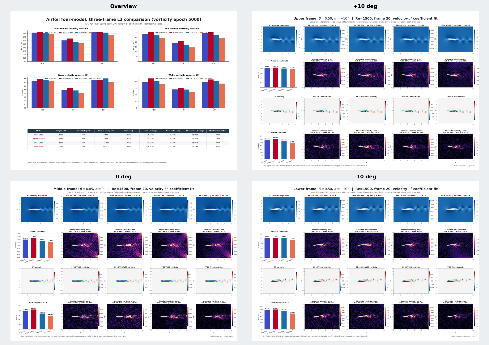
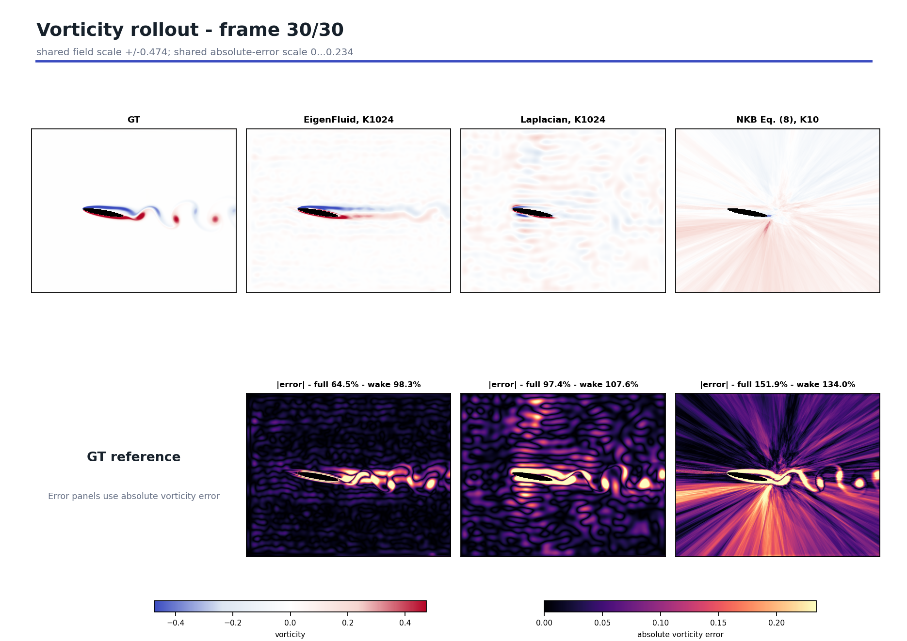

# 2D airfoil results

## Files

- [three-frame L2 PDF](artifacts/airfoil_four_model_three_frame_l2_comparison.pdf)
- [first six modes PDF](artifacts/airfoil_four_method_lowest6_modes_three_frames.pdf)
- [rollout30 PDF](artifacts/airfoil_rollout30_gt_eigenfluid_laplacian_neural_kinematic_bases.pdf)
- [rollout30 MP4](artifacts/airfoil_rollout30_gt_eigenfluid_laplacian_neural_kinematic_bases_10fps.mp4)
- [metrics](metrics)
- [SHA-256](checksums.sha256)

## Three-frame reconstruction

| Model | Epoch | Time | Velocity full | Velocity wake | Vorticity full | Vorticity wake |
|---|---:|---:|---:|---:|---:|---:|
| FP16 velocity 100% | 1000 | 9.43 h | 1.89% | 3.32% | 25.58% | 36.05% |
| FP16 hybrid 50/50 | 650 | 3.90 h | 1.95% | 3.51% | 27.15% | 39.78% |
| FP64 velocity 100% | 5000 | 115.82 h | 1.82% | 3.44% | 23.65% | 36.80% |
| **FP16 vorticity 100%** | **5000** | **29.43 h** | **1.71%** | **3.11%** | **20.75%** | **32.68%** |



## Rollout30

Mean / final relative L2.

| Method | Velocity full | Velocity wake | Vorticity full | Vorticity wake |
|---|---:|---:|---:|---:|
| **EigenFluid K1024** | **7.39% / 9.35%** | **16.14% / 21.89%** | **54.17% / 64.51%** | **78.58% / 98.25%** |
| Laplacian K1024 | 17.53% / 20.17% | 26.76% / 30.15% | 91.85% / 97.38% | 100.76% / 107.55% |
| NKB Eq. (8), K10 | 84.07% / 181.61% | 58.93% / 90.03% | 120.92% / 151.95% | 111.89% / 134.05% |



## Reproduce

```powershell
$case = "BasisNet/cases/2D_airfoil"
$config = "$case/configs/k1024_c2_sobol_10000_fp16_vorticity100.json"
$run = "$case/results/k1024_c2_sobol_10000_fp16_vorticity100/run_001"

python "$case/scripts/prepare_hardcoded_run.py" --config $config --output-dir "$run/reference_inputs"
python -u "$case/scripts/train_hardcoded.py" --resume "$run/reference_inputs/initial_epoch0000.npz" --run-dir $run --epochs 5000 --validation-pack "$run/reference_inputs/fixed_validation_scipy_sobol_v1.npz" --archive-checkpoint-every 500 --early-stopping-patience-epochs 5000
```

| Input/output | SHA-256 |
|---|---|
| epoch 0 | `b1eb27bbc8f1c6f7dc5ece82ac852dd3f2842952c1dcd48d6acdb0e0b68f69a5` |
| validation pack | `fa1817e4a83bbe93846bba84cb2af050d7a9b67ed37f9db0930ac1b56bbc11df` |
| epoch 5000 | `f1ac263de87dd6f1a0370741f76c1fce309073b8561be5a314d89d144c0b981d` |

Rollout scripts:

```text
scripts/rollout_eigenfluid_rom.py
scripts/rollout_laplacian_rom.py
scripts/train_neural_kinematic_baseline.py
scripts/rollout_neural_kinematic_baseline.py
scripts/build_neural_rollout_comparison.py
```

Checkpoints and full field NPZ files are regenerated locally and are not stored in Git.
