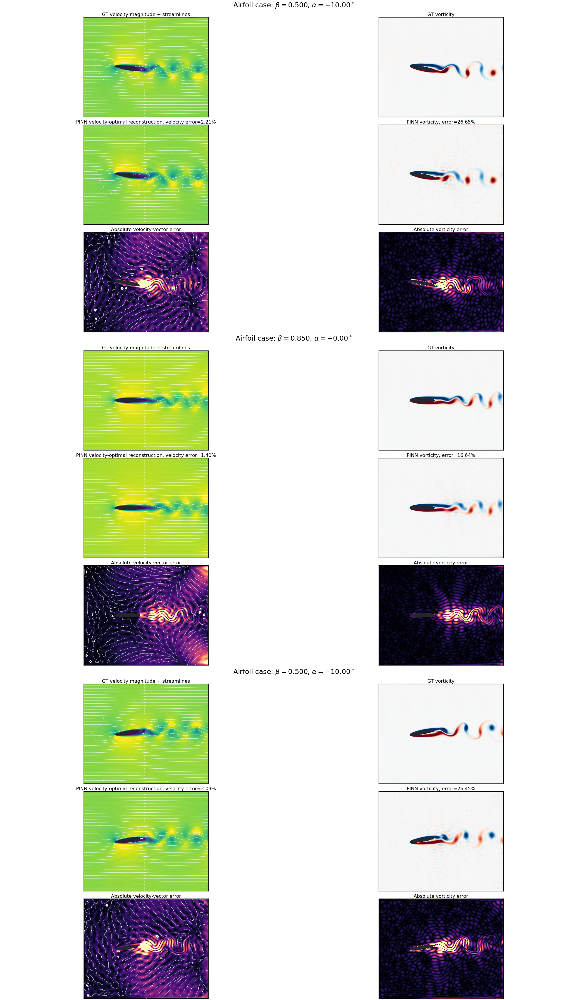
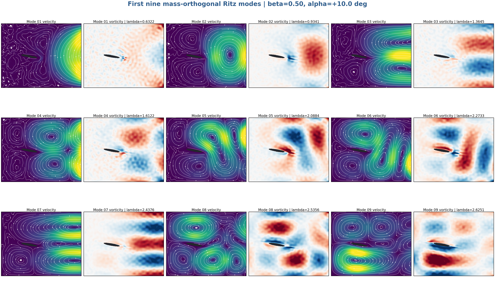
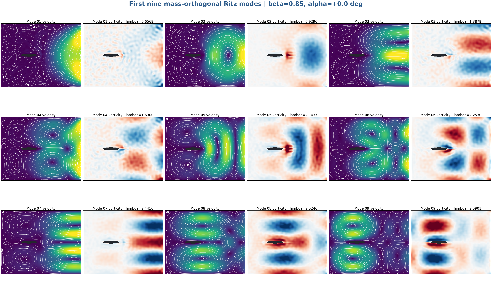
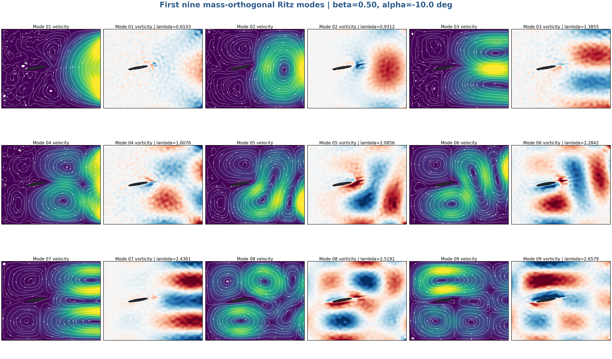
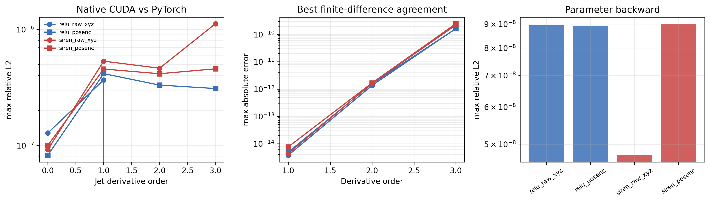

# Pure-CUDA step-5000 results

## Protocol

- seed: `20260801`
- modes: `1024` in every optimizer step
- quadrature: `4096` scrambled Sobol points over physical fluid area
- field: 2D antisymmetric NCL tensor, `u = div(A)`
- derivatives: continuous analytic compact symmetric Jet3
- parameter gradient: handwritten reverse pass
- objective: unscaled vorticity Rayleigh quotient only
- precision: FP16 MLP operands with FP32 accumulation; all remaining paths FP32
- PyTorch/autodiff/finite differences in training: none
- evaluated checkpoint: optimizer step `5000`

The checkpoint and generated NPZ fields are not versioned. They are reproduced
from the checked-in configuration and deterministic reference-input metadata.

## Three-case evaluation

| alpha | beta | Ritz rank | velocity rel. L2 | wake velocity rel. L2 | vorticity rel. L2 |
|---:|---:|---:|---:|---:|---:|
| +10 deg | 0.50 | 1024 | 2.212% | 4.743% | 26.652% |
| 0 deg | 0.85 | 1024 | 1.397% | 2.586% | 16.641% |
| -10 deg | 0.50 | 1024 | 2.090% | 4.380% | 26.449% |



## First nine Ritz modes

### alpha = +10 deg, beta = 0.50



### alpha = 0 deg, beta = 0.85



### alpha = -10 deg, beta = 0.50



## Network-only Jet3 validation

All four controlled variants pass the native-CUDA versus PyTorch-autograd
slot checks and handwritten parameter-backward checks.



Files:

- [`step5000_evaluation_and_network_ablation.pdf`](step5000_evaluation_and_network_ablation.pdf)
- [`metrics.json`](metrics.json)
- [`network_jet3_ablation.json`](network_jet3_ablation.json)
- [`network_jet3_slot_errors.csv`](network_jet3_slot_errors.csv)

## Reproduce step 5000

From the repository root:

```powershell
$case = "BasisNet/cases/2D_airfoil"
$config = "$case/configs/k1024_ncl_cinf_sobol_10000_fp16_pure_vorticity_rayleigh.json"
$run = "$case/results/k1024_ncl_cinf_sobol_10000_fp16_pure_vorticity_rayleigh/run_001"

python "$case/scripts/prepare_hardcoded_run.py" `
  --config $config `
  --output-dir "$run/reference_inputs"

python -u "$case/scripts/train_hardcoded.py" `
  --resume "$run/reference_inputs/initial_epoch0000.npz" `
  --validation-pack "$run/reference_inputs/fixed_validation_scipy_sobol_v1.npz" `
  --run-dir $run `
  --epochs 5000
```

The evaluation scripts accept the reproduced step-5000 checkpoint and the
independently generated Re=1500 reference fields:

```powershell
python "$case/scripts/evaluate_three_typical_cases.py" --help
python "$case/scripts/render_first9_modes.py" --help
python "$case/scripts/network_jet3_ablation.py" --help
python "$case/scripts/build_step5000_compact_pdf.py" --help
```
