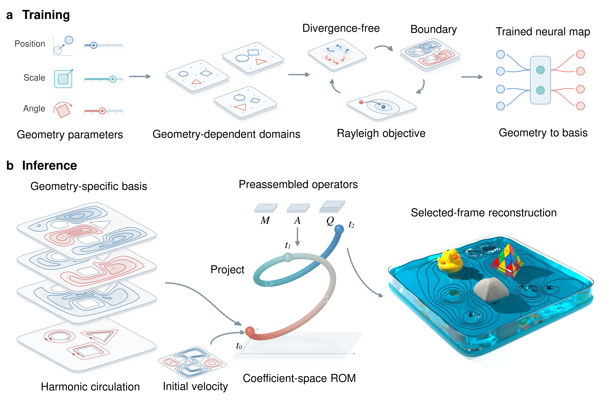
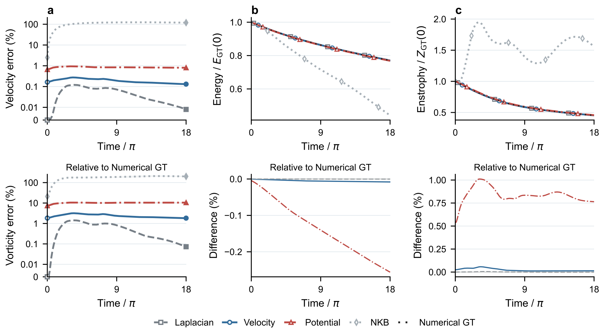
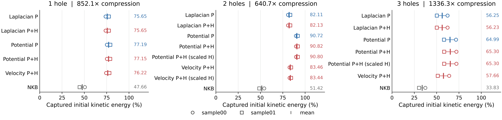
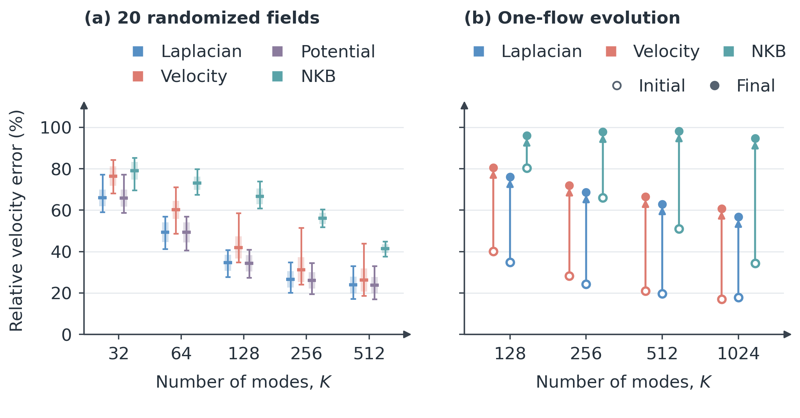

# Neural Eigenfluid Bases

**Continuous spectral coordinates for incompressible flow.**

Code and trained models for **Neural Eigenfluid Bases: Spectral Objectives, Gauge, and Topology**, by Baiming Zhang, Shiying Xiong, and Zhecheng Wang.

[Paper (54 pages)](paper/Neural_Eigenfluid_Bases.pdf) · [Reproduction guide](docs/REPRODUCIBILITY.md) · [Checkpoints](https://github.com/baiming-zhang/NEB/releases/tag/paper) · [Executed checks](docs/REPRODUCTION_CHECKS.md) · [Experiment index](docs/EXPERIMENTS.md)

Neural eigenfluids combine analytic differential lifts, spectral ordering, and harmonic circulation coordinates. These spatial bases support full-mass projection and autonomous Galerkin evolution with reusable operators. The experiments study periodic vortex merger, flow around multiple obstacles, and three-dimensional Metaball flow.



## Methods

| Paper name | Formulation |
|---|---|
| **Potential** | Potential-space spectral learning; canonical potential coordinates in 3D |
| **Velocity** | Velocity-space spectral learning through an analytic differential lift |
| **Laplacian** | Numerical spectral basis at the same retained dimension |
| **NKB** | Geometry-only neural kinematic basis with direct velocity output |
| **Potential-FG** | Potential-space learning with a finite gauge projector |
| **Potential-AL** | Potential-space learning with augmented-Lagrangian gauge constraints |

Both Potential and Velocity produce velocities from neural potentials. Harmonic coordinates represent independent obstacle circulations. Comparisons use their stated physical quadrature, full mass system, and retained mode count.

## Install and reproduce

Use Python 3.11 or newer. Run these commands from the repository root:

```bash
python -m venv .venv
# Linux/macOS: source .venv/bin/activate
# Windows:    .venv\Scripts\Activate.ps1
python -m pip install -e ".[test,fem]" -c requirements-repro.txt
python -m pytest tests -q
neb figures --output outputs/paper_figures
```

The figure command runs on CPU and exports PNG and vector PDF comparisons from the supplied paper measurements. Native neural training and evaluation use CuPy and CUDA 12:

```bash
python -m pip install -e ".[cuda,torch,fem,test]" -c requirements-repro.txt
```

The neural networks use native CuPy/CUDA with analytic spatial derivatives and handwritten parameter reverse passes. The `torch` extra supplies the existing Metaball DNS, target-generation and geometry/sampling utilities. CPU numerical routines and NumPy evaluation remain available.

The 3D canonical inverse also uses an installed oneMKL LP64 runtime or cuDSS 0.8 library. [Solver setup](experiments/metaball/USAGE.md) describes both options.

## Trained checkpoints

The [paper release](https://github.com/baiming-zhang/NEB/releases/tag/paper) supplies trained models and Potential-AL multiplier state. [The checkpoint index](checkpoints/index.json) lists each model's case, method, capacity, configuration, and endpoint.

With the GitHub CLI installed:

```bash
neb checkpoints
neb checkpoints --download --only periodic-potential-k1024-seed0
neb checkpoints --download
```

Downloaded models are placed under `checkpoints/2d/` and `checkpoints/3d/`, beside their metadata. Use the model's `config` path from the index for training or evaluation.

The collection contains 88 models trained for 2000 updates, the K1024 Potential 25-update timing endpoint, and three Potential-AL multiplier archives.

All 89 model configurations and 92 model/state files are retained. Names describe the case, method, capacity and replicate. Metaball's `seed0` is a replicate label; its numerical RNG seed is preserved in the configuration. Run `python tools/check_reproduction.py --models` after downloading to open the saved parameter and optimizer arrays; add `--native` for small saved-model execution checks. No SHA manifests are needed.

| Experiment | Models supplied |
|---|---|
| Periodic vortex merger | Potential, Velocity, NKB at K=1024; seeds 0, 1, 2 |
| One-, two-, and three-hole domains | Potential and Velocity at K=32; seeds 1, 2, 3; K=1024 positive/completed allocations |
| Harmonic circulation | Raw and scaled harmonic lifts for all three topologies and seeds |
| 3D Metaball | Potential through K=512; Velocity/NKB through K=1024; finite-gauge and augmented-Lagrangian controls |

## Periodic vortex merger

The periodic case uses a 256² operator grid, 128² observations, K=1024, and 241 states through T=18π. Generate the numerical reference and evaluate a trained Potential basis:

```bash
python experiments/periodic/run.py dns --output runs/periodic/dns
python experiments/periodic/run.py evaluate --method Potential --seed 0 \
  --checkpoint checkpoints/2d/periodic-potential-k1024-seed0/model.npz \
  --gt runs/periodic/dns --output runs/periodic/potential
```

Use `--method Velocity` or `--method NKB` with its corresponding checkpoint. [Case commands](experiments/periodic/README.md) include fresh training, the same-capacity Laplacian control, and trajectory plots.



## Multiply connected flow

The obstacle cases compare positive-spectrum coordinates and harmonic completion at fixed total dimension. Quintic random streamfunctions and compact large vortices provide paired physical targets. Input generators retain their seeds, boundary conditions, and normalization. Reference meshes, numerical spectral bases, learned operators, and autonomous trajectories have separate entry points.

[Projection and training](experiments/multihole/README.md) · [Numerical references](experiments/multihole/reference/USAGE.md) · [Learned dynamics](experiments/multihole/learned_rom/README.md) · [NKB](experiments/2d/nkb/README.md)



## Three-dimensional Metaball flow

The 3D comparisons use all 1,599,754 fluid points and every retained coordinate. The main random-field comparison contains 400 measurements through K=512; the appendix adds 60 K=1024 measurements for Laplacian, Velocity, and NKB. The same 20 independent fields are paired across methods and capacities. Autonomous trajectories, held-out geometries, gauge solvers, and coefficient dynamics have dedicated recipes.

[Generation, training, and evaluation](experiments/metaball/USAGE.md) · [Gauge experiments](experiments/gauge/USAGE.md) · [Curved held-out geometry](experiments/metaball/GEOMETRY4.md)



## Repository layout

```text
experiments/periodic/       Periodic reference, training, and full-mass rollout
experiments/multihole/      Obstacle geometries, circulation, and dynamics
experiments/metaball/       3D learning, projection, transfer, and dynamics
experiments/gauge/          Finite, spline, FMM, and Fourier gauge experiments
checkpoints/               Model index and per-model metadata
data/                      Measurements and preparation-cost estimates
paper/                     Manuscript PDF, LaTeX sources, and PNG/PDF artwork
src/neb/                   Checkpoint retrieval and measurement plots
tests/                     CPU numerical and interface checks
docs/                      Reproduction protocol and experiment map
```

Configurations specify initialization, architecture, sampling, precision, optimizer, and validation cadence. The 3D trainers save complete model and Adam state every 100 updates and at the endpoint; Potential-AL also saves its multipliers. Preparation-cost forecasts carry the paper's asterisk notation in the supplied data.

## Citation

```bibtex
@misc{zhang_neural_eigenfluid_bases,
  title  = {Neural Eigenfluid Bases: Spectral Objectives, Gauge, and Topology},
  author = {Zhang, Baiming and Xiong, Shiying and Wang, Zhecheng},
  year   = {2026}
}
```
