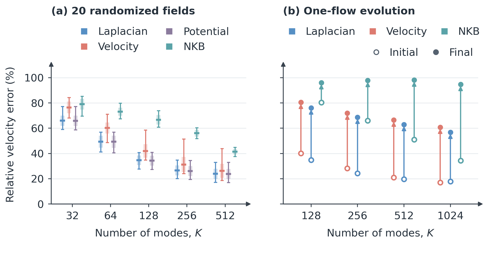
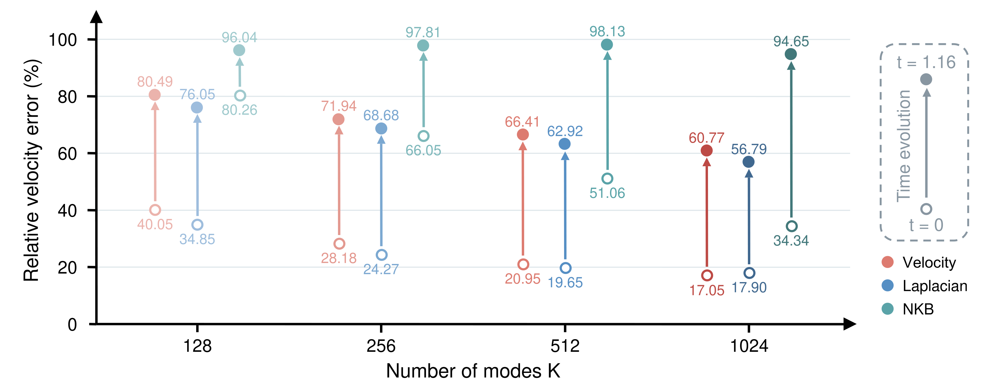

# NEB: Neural Eigenfluid Bases

**Continuous spectral coordinates for incompressible flow.**

Code for **Neural Eigenfluid Bases: Spectral Objectives, Gauge, and Topology** by Baiming Zhang, Shiying Xiong, and Zhecheng Wang.

Neural eigenfluids learn spatial coordinates that satisfy incompressibility through analytic differential lifts. Geometry-local spectral orthogonalization turns these continuous fields into reusable bases for full-mass projection and autonomous Galerkin dynamics. Learning in potential space provides a lower-derivative spectral formulation, while harmonic coordinates encode the independent circulations of multiply connected domains.

The experiments connect three aspects of reduced fluid simulation: **spectral learning**, **topological completion**, and **reusable coefficient dynamics**. At K=1024, the periodic vortex-merger experiment achieves sub-percent mean velocity error with the streamfunction formulation. The multiply connected experiments examine positive-mode and circulation allocation on the same physical initial fields. The 3D experiments compare representation capacity and autonomous evolution, then reuse assembled operators for rapid coefficient updates.

## Manuscript and measured results

[Paper PDF](paper/Neural_Eigenfluid_Bases.pdf) · [LaTeX sources](paper/) · [460 paired NEW20 measurements](data/paper_results/mainfour_NEW20_460_measurements.csv)

The manuscript reports 20 main-comparison groups through K512 on the same 20 independent fields (400 measurements), with three K1024 groups in the appendix (60 measurements), and four separately matched Potential-FG controls. All 26 included figures are supplied as PNG and vector PDF. Potential K512 completes 2000 training updates; the K1024 timing endpoint completes 25 updates. Training-cost projections are marked with an asterisk and remain separate from measured runs and accuracy results.

The [boundary-to-all-basis timings](data/paper_results/primary_basis_runtime.csv) report Velocity K512/K1024 at 488.29/747.68 s and Laplacian K32/K64/K128/K256/K512/K1024 at 3467.56/2545.51/3576.89/5548.86/9246.67/22049.01 s. Each interval evaluates all 1,599,754 fluid points and all retained modes, including streamed output. The Laplacian interval also includes fresh coefficient construction, interstage waits, setup, paging and background load.



## Methods

| Name | Formulation |
|---|---|
| **Potential** | Potential-space Rayleigh training in 2D and canonical potential-space training in 3D |
| **Velocity** | Velocity-space Rayleigh training through a potential network and differential lift |
| **Laplacian** | Numerical spectral basis at the same capacity |
| **NKB** | Direct-velocity neural kinematic basis |
| **Potential-FG** | Finite scalar/harmonic gauge control |
| **Potential-AL** | Augmented-Lagrangian potential control |

Potential and Velocity both generate velocities from neural potentials; NKB outputs velocities directly. Spatial derivatives are evaluated analytically. Projection uses the full mass matrix, and the reduced dynamics evolve coefficients with the assembled Galerkin operators. Experiment configurations specify geometry, sampling, initialization, optimizer, precision, capacity, and validation cadence.

## Installation

Use Python 3.11 or newer in a virtual environment. From the repository root:

```bash
python -m pip install -e ".[test,fem]" -c requirements-repro.txt
python -m pytest tests -q
neb figures --output outputs/paper_figures
```

The first workflow runs on CPU and redraws the supplied measurements as PNG and vector PDF. For native training and reference assembly, install the experiment dependencies:

```bash
python -m pip install -e ".[cuda,torch,fem]" -c requirements-repro.txt
```

The native spectral trainers use CuPy with CUDA 12. The 3D canonical solvers use an explicit oneMKL LP64 runtime or cuDSS 0.8 library; the [Metaball guide](experiments/metaball/USAGE.md) specifies the solver selection and installation paths. Each experiment directory documents its inputs and commands.

## Reference checkpoints

The [reference-checkpoint release](https://github.com/baiming-zhang/NEB/releases/tag/paper-v1.0) contains selected trained models. The source repository includes the corresponding configurations and a SHA256 manifest.

With the GitHub CLI installed and authenticated:

```bash
neb checkpoints
neb checkpoints --download
```

Select individual models with `--only CHECKPOINT_ID`. Files are verified after download and placed under `checkpoints/2d/` or `checkpoints/3d/`. These models provide a direct starting point for basis evaluation, full-mass projection, and coefficient evolution; the training commands reproduce their configurations from fresh initialization.

| Experiment | Reference models | Capacity |
|---|---|---:|
| Periodic vortex merger | Potential, Velocity, NKB | 1024 |
| Two- and three-hole domains | Velocity | 32 |
| Harmonic circulation | Raw and scaled lifts | 1 |
| 3D Metaball | Potential, Velocity, Potential-AL, NKB | 32 |

All eleven reference models are saved at epoch 2000. The manifest lists their individual download IDs, sizes and hashes; adjacent JSON files retain the model configurations.

## Periodic vortex merger

The periodic case compares learned and Fourier bases at K=1024 over 18π time units. It uses a 256×256 quadrature grid, a 128×128 observation grid, and 241 saved states. Three learned initialization seeds provide the paper's mean and sample standard deviation.

Generate the reference flow and evaluate the supplied Potential checkpoint:

```bash
python experiments/periodic/run.py dns --output runs/periodic/dns
python experiments/periodic/run.py evaluate --method Potential --seed 0 \
  --checkpoint checkpoints/2d/K1024_potential_rayleigh_seed0/hardcoded_epoch2000.npz \
  --gt runs/periodic/dns --output runs/periodic/sfr_evaluation
```

Train from the paper configuration:

```bash
python experiments/periodic/run.py prepare \
  --config experiments/periodic/configs/K1024_potential_rayleigh_seed0.json \
  --output runs/periodic/sfr
python experiments/periodic/run.py train \
  --checkpoint runs/periodic/sfr/initial_epoch0000.npz \
  --output runs/periodic/sfr
```

Use `K1024_velocity_rayleigh_seed0.json` and `--method Velocity` for the Velocity objective.

## Multiply connected domains

The one-, two-, and three-hole cases study positive-spectrum coordinates and harmonic circulation completion. Twenty fixed quintic streamfunctions per topology support paired projection comparisons, with impermeability and boundary-vorticity conditions built into the field construction. The compact Wendland vortex ensemble provides the trajectory protocol for harmonic allocation and raw/scaled lift controls. Both ensembles have dedicated generators and preserve the same physical initial field across their basis comparisons.

```bash
python experiments/multihole/run.py fields --case circle_square \
  --output runs/multihole/circle_square/fields
python experiments/multihole/run.py prepare \
  --config experiments/multihole/configs/circle_square_velocity_k32_seed1.json \
  --output runs/multihole/circle_square/vrq
python experiments/multihole/run.py train \
  --checkpoint runs/multihole/circle_square/vrq/initial_epoch0000.npz \
  --output runs/multihole/circle_square/vrq
python experiments/multihole/run.py harmonic-train \
  --config experiments/multihole/configs/circle_square_harmonic_seed1.json \
  --output runs/multihole/circle_square/harmonic
python -m experiments.multihole.reference.run --mode mesh --case circle_square \
  --output runs/multihole/circle_square/mesh
python -m experiments.multihole.reference.run --mode operators --case circle_square \
  --mesh runs/multihole/circle_square/mesh/mesh.npz \
  --output runs/multihole/circle_square/operators
python experiments/multihole/evaluate.py \
  --checkpoint checkpoints/2d/circle_square_velocity_k32_seed1/epoch2000.npz \
  --fields runs/multihole/circle_square/fields \
  --quadrature runs/multihole/circle_square/operators/quadrature.npz \
  --output runs/multihole/circle_square/vrq_projection
```

The configuration collection includes positive and harmonic training, raw and scaled lift controls, and fixed-capacity allocations. The [multihole guide](experiments/multihole/README.md) gives the P/PH projection commands. The [learned dynamics guide](experiments/multihole/learned_rom/README.md) constructs the full-mass Galerkin operators, advances autonomous trajectories and compares them with the physical reference. The [reference guide](experiments/multihole/reference/USAGE.md) provides adaptive meshes, P3 reference trajectories, compact-vortex ensembles and full-space Laplacian controls. The [NKB guide](experiments/2d/nkb/README.md) covers geometry-only training and its coefficient dynamics.

## 3D Metaball

The 3D experiments use the same physical target and same-capacity Laplacian controls for full-domain projection. They include the Velocity and Potential objectives, gauge-constrained potential controls, NKB, gauge-solver ablations, held-out geometry, and coefficient-space dynamics. Capacities and method-specific configurations are supplied with the experiment sources.

Generate the analytic source samples and evaluate the reference Velocity model on the full physical grid:

```bash
python experiments/metaball/prepare.py source --output runs/metaball/source
python experiments/metaball/prepare.py dns --output runs/metaball/dns
python experiments/metaball/prepare.py random20 \
  --dns runs/metaball/dns --output runs/metaball/targets
python experiments/metaball/evaluate.py --method VRQ --K 32 \
  --config experiments/metaball/configs/vrq_ccq_k32.json \
  --checkpoint checkpoints/3d/vrq_k32_e2000.npz \
  --samples runs/metaball/source/samples.npz \
  --flat runs/metaball/targets/fluid_flat_indices.npy \
  --coordinates runs/metaball/dns/coordinates.npy \
  --output runs/metaball/vrq_basis
```

The [Metaball guide](experiments/metaball/USAGE.md) continues with Potential physical operators, full-mass paired projection, Velocity capacity sweeps and assembled coefficient dynamics. The [gauge guide](experiments/gauge/USAGE.md) gives finite-space, spline, volume-FMM and Fourier controls. The [quadratic geometry guide](experiments/metaball/GEOMETRY4.md) reproduces the held-out Nédélec mesh, curved physical chart, 264-vector Ritz solve and 256-mode reconstruction.

The paired-field comparison in [`data/paper_results/mainfour_NEW20_460_measurements.csv`](data/paper_results/mainfour_NEW20_460_measurements.csv) contains 23 method-capacity groups on the same 20 independent random fields: 20 groups through K512 in the main figure and three K1024 groups in the appendix. Potential-FG contributes four separately matched control groups. Error bars show sample standard deviation across fields, with `ddof=1`. The `metaball_capacity.json` measurements separate initial representation from autonomous evolution. At K512, Potential training takes 140.20 h versus 3.99 h for Velocity, while the Potential and Laplacian random-field mean errors differ by 0.17 percentage points. Velocity or Laplacian is therefore the practical choice for larger capacities in this 3D case.

Regenerate the combined randomized-field/autonomous-evolution figure with `python tools/redraw_combined_metaball.py --repo . --output outputs/combined_metaball`; the two panels retain 10-point text at final print size and use consistent method colors and arrowed axes. Regenerate the initial-capacity/training panel with `python tools/redraw_metaball_reported_scope.py --output outputs/reported_metaball`.



## Repository layout

```text
experiments/periodic/     Periodic data generation, training, and full-mass rollout
experiments/multihole/    Random streamfunctions, positive and harmonic coordinates
experiments/metaball/     3D spectral learning, projection, and reduced dynamics
experiments/gauge/        Canonical gauge and solver experiments
src/neb/                 Checkpoint retrieval and paper-data plotting
checkpoints/             Reference configurations and download manifest
data/paper/              Numerical measurements used by the paper
assets/figures/           PNG and vector PDF comparisons
tests/                   CPU numerical and reproduction checks
```

Each case includes its numerical kernels and dependency closure. Case entry points take explicit configuration, checkpoint, data, and output paths. The [visualization guide](experiments/VISUALIZATIONS.md) covers the ten supplied measurement plots, field plates and basis atlases.

## Measurements and citation

Velocity errors use the stated full-domain or observation-grid relative L2 measure. Seed statistics and initial-field statistics are computed within their respective experiment protocols. Projection, training, reference assembly, and online coefficient evolution retain their separate timing boundaries. Figure data provenance is recorded in `data/paper/provenance.json`.

```bibtex
@misc{zhang_neural_eigenfluid_bases,
  title  = {Neural Eigenfluid Bases: Spectral Objectives, Gauge, and Topology},
  author = {Zhang, Baiming and Xiong, Shiying and Wang, Zhecheng},
  year   = {2026}
}
```

See `CITATION.cff` for a machine-readable citation.

Preparation-cost estimates and their measured update counts, fit coefficients and timing assumptions are provided in [`preparation_cost_estimates.json`](data/paper_results/preparation_cost_estimates.json). Asterisks identify forecasts; recovery marked `incl.` is already part of the recorded training total.
